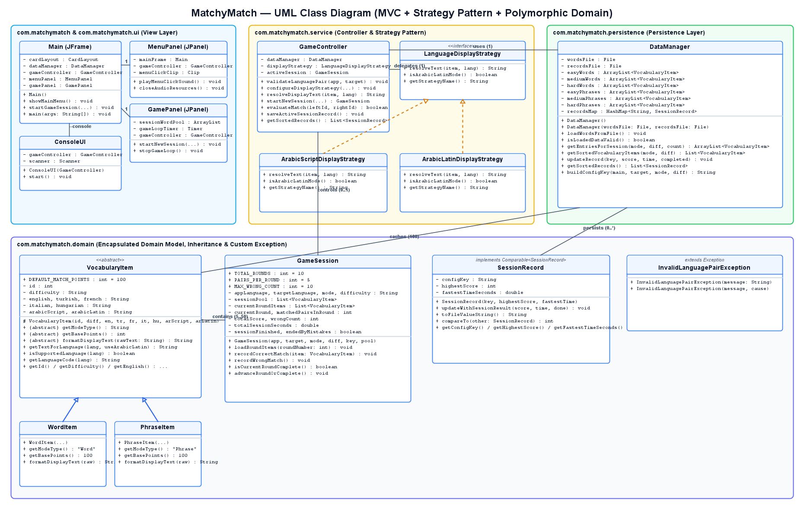

# MatchyMatch — Multi-Language Vocabulary Matching Game

**MatchyMatch** is a self-contained, object-oriented desktop and console vocabulary matching game built in **Java 17** using **Maven**, **Java Swing / AWT (`Graphics2D`)**, and **JUnit 5**. Designed for university-level Object-Oriented Programming (**Programming 2**), it combines a clean **Model–View–Controller (MVC)** and **Strategy Pattern** architecture with a 60 FPS custom-rendered Swing GUI and an interactive command-line interface (`--console`).

---

## Author & Contributors

- **Developer / Maintainer:** [`neo-cod`](https://github.com/neo-cod)

---

## Implemented Features

1. **6 Supported Languages:** Practice vocabulary between any pair of **English**, **Turkish**, **French**, **Italian**, **Hungarian**, and **Arabic**.
2. **Dynamic Arabic Alphabet Rule (Strategy Pattern):** Seamlessly switch Arabic display between **Arabic Script (`مرحبا`)** and **Romanized Latin Transliteration (`Marhaba`)** at runtime using `LanguageDisplayStrategy`.
3. **2 Game Modes & 3 Difficulty Tiers:**
   - **Modes:** `Word` (single words, modeled by `WordItem`) and `Phrase` (everyday expressions & idioms, modeled by `PhraseItem`).
   - **Difficulties:** `Easy`, `Medium`, and `Hard` (180 total curated entries across 6 categorized `ArrayList<VocabularyItem>` collections).
4. **10-Round Gameplay, `+100` Scoring & 10-Mistake Game-Over Rule:**
   - Each session consists of **10 Rounds** with **5 Pairs per Round** (50 total pairs per session).
   - Every correct match awards a flat **`+100` points** (`VocabularyItem.getBasePoints()`).
   - Every wrong match increments **`Wrong Count`** by `1`; reaching **10 wrong attempts** immediately triggers **`GAME OVER!`**.
5. **60 FPS Custom Swing GUI & Synthesized Audio:**
   - Pure white (`#FFFFFF`) minimalist theme featuring bicubic-scaled `matchy-logo.png`, pool-blue (`#38BDF8`) circular Info (`i`) and geometric 8-tooth Settings gear icons, click-to-cycle configuration cards, smooth fade/shake animations, and zero-dependency procedural PCM sound effects (`javax.sound.sampled.Clip`).
6. **Interactive Console UI (`--console`):**
   - Full `Scanner`-based terminal mode supporting playable matching rounds, language/strategy configuration, `Comparable`-sorted personal record leaderboards, and `Comparator`-sorted vocabulary lists.
7. **Persistent Personal Records (`records.txt`) & Self-Healing Dataset (`words.csv`):**
   - Automatically generates `words.csv` if missing or corrupted and persists `Highest Score` and `Fastest Time` per configuration key (e.g., `EN-TR-WORD-EASY`) in `records.txt`.

---

## Architecture & Package Structure

```text
MatchyMatch/
├── pom.xml                                      # Maven build configuration (Java 17, JUnit 5, exec-maven-plugin)
├── LICENSE                                      # MIT License
├── README.md                                    # Project documentation
├── matchy-logo.png                              # Custom game logo rendered on Main Menu
├── words.csv                                    # 180-entry 6-language vocabulary dataset
├── records.txt                                  # Persistent personal records (Highest Score & Fastest Time)
├── docs/
│   ├── UML_Class_Diagram.md                     # Detailed UML Class Diagram (Mermaid + PNG + relationships)
│   ├── uml_class_diagram.puml                   # PlantUML source file
│   ├── uml_class_diagram.png                    # High-resolution rendered UML Class Diagram image
│   └── User_Stories.md                          # 6 User Stories, Acceptance Criteria, Design Decisions & Limitations
└── src/
    ├── main/java/com/matchymatch/
    │   ├── Main.java                            # Entry point (launches Swing JFrame or ConsoleUI with --console)
    │   ├── domain/
    │   │   ├── VocabularyItem.java              # Abstract superclass encapsulating 6-language vocabulary data
    │   │   ├── WordItem.java                    # Concrete subclass for single-word entries ("Word" mode)
    │   │   ├── PhraseItem.java                  # Concrete subclass for multi-word expressions ("Phrase" mode)
    │   │   ├── SessionRecord.java               # Record entity implementing Comparable<SessionRecord>
    │   │   ├── GameSession.java                 # Composes round items, score, wrongCount, and session state
    │   │   └── InvalidLanguagePairException.java# Custom checked exception for invalid/identical language pairs
    │   ├── service/
    │   │   ├── LanguageDisplayStrategy.java     # Strategy interface for resolving language text
    │   │   ├── ArabicScriptDisplayStrategy.java # Concrete strategy for native Arabic script (مرحبا)
    │   │   ├── ArabicLatinDisplayStrategy.java  # Concrete strategy for Latin transliteration (Marhaba)
    │   │   └── GameController.java              # MVC Controller coordinating sessions, strategies & validation
    │   ├── persistence/
    │   │   └── DataManager.java                 # File I/O (BufferedReader/Writer, try-with-resources, Collections)
    │   └── ui/
    │       ├── MenuPanel.java                   # Custom Swing Main Menu JPanel
    │       ├── GamePanel.java                   # 60 FPS Graphics2D gameplay JPanel
    │       └── ConsoleUI.java                   # Interactive Scanner-based CLI
    └── test/java/com/matchymatch/
        └── MatchyMatchTest.java                 # 8 JUnit 5 unit tests covering OOP, Strategy, Sorting & File I/O
```

---

## Object-Oriented Design & Applied Design Patterns

1. **Strategy Design Pattern (`com.matchymatch.service.LanguageDisplayStrategy`):**
   - Defines a common interface (`resolveText(VocabularyItem, String)`) implemented by `ArabicScriptDisplayStrategy` and `ArabicLatinDisplayStrategy`.
   - `GameController` dynamically switches the active strategy at runtime based on whether the user selects **Arabic Script (`مرحبا`)** or **Latin Alphabet (`Marhaba`)**, keeping UI classes decoupled from script-formatting rules.
2. **Model–View–Controller (MVC) Pattern:**
   - **Model (`domain` & `persistence`):** `VocabularyItem`, `WordItem`, `PhraseItem`, `GameSession`, `SessionRecord`, and `DataManager` encapsulate state and file persistence independently of any user interface.
   - **View (`ui`):** `MenuPanel`, `GamePanel`, and `ConsoleUI` handle presentation and user input.
   - **Controller (`service.GameController`):** Mediates between Views and the Model, enforcing language pair validation (`InvalidLanguagePairException`), match evaluation, and record sorting.

---

## Technical Requirements Mapping Table

| Prog 2 Rubric Requirement | Implementation in MatchyMatch | Key Methods / Details |
| :--- | :--- | :--- |
| **Encapsulation & Validation** | `com.matchymatch.domain.VocabularyItem`<br>`com.matchymatch.domain.SessionRecord` | `private final` fields, controlled getters, and constructor validation throwing `IllegalArgumentException` on invalid IDs or blank strings. |
| **Inheritance (`extends`)** | `WordItem extends VocabularyItem`<br>`PhraseItem extends VocabularyItem` | Both subclasses inherit the 9 language fields from `VocabularyItem` via `super(...)` and specialize mode behavior. |
| **Polymorphism & Method Overriding** | `VocabularyItem`, `WordItem`, `PhraseItem`, `DataManager`, `GameSession` | `DataManager` and `GameSession` store `WordItem` and `PhraseItem` instances in polymorphic `ArrayList<VocabularyItem>` lists and invoke overridden `getModeType()`, `getBasePoints()`, and `formatDisplayText(String)`. |
| **Abstract Class** | `com.matchymatch.domain.VocabularyItem` | Declares abstract methods `getModeType()`, `getBasePoints()`, and `formatDisplayText(String)`. |
| **Interface & Design Pattern** | `com.matchymatch.service.LanguageDisplayStrategy` | Implemented by `ArabicScriptDisplayStrategy` and `ArabicLatinDisplayStrategy` (**Strategy Pattern**). |
| **Object Sorting (`Comparable` & `Comparator`)** | `SessionRecord implements Comparable<SessionRecord>`<br>`DataManager.getSortedVocabularyItems(...)` | `SessionRecord.compareTo` sorts records by highest score descending, then fastest time ascending; `DataManager` uses `Comparator<VocabularyItem>` to sort vocabulary alphabetically. |
| **Custom Checked Exception** | `com.matchymatch.domain.InvalidLanguagePairException` | Extends `java.lang.Exception`; thrown by `GameController.validateLanguagePair(...)` when main and target languages are identical or unsupported, and caught in `MenuPanel` & `ConsoleUI`. |
| **File I/O (`try-with-resources`)** | `com.matchymatch.persistence.DataManager` | Uses `BufferedReader`, `BufferedWriter`, `FileReader`, and `FileWriter` with `StandardCharsets.UTF_8` inside `try-with-resources` blocks for `words.csv` and `records.txt`. |
| **Java Collections (`ArrayList`, `HashMap`)** | `com.matchymatch.persistence.DataManager` | 6 categorized `ArrayList<VocabularyItem>` lists (`easyWords`..`hardPhrases`) + `HashMap<String, SessionRecord>` (`recordsMap`). |
| **JUnit 5 Unit Tests** | `src/test/java/com/matchymatch/MatchyMatchTest.java` | 8 `@Test` methods testing inheritance/polymorphism, constructor validation, Strategy switching, `InvalidLanguagePairException`, `Comparable`, `Comparator`, `+100` scoring / 10-wrong Game Over, and `@TempDir` persistence. |

---

## Prerequisites

- **Java Development Kit (JDK):** Version **17** or newer (compatible with JDK 17–25+)
- **Apache Maven:** Version **3.8+** (or run directly via IntelliJ IDEA's bundled Maven)

---

## How to Build, Test, and Run

### 1. Compile and Run All JUnit 5 Unit Tests
```bash
mvn clean test
```

### 2. Run the Desktop Swing GUI (Default Mode)
```bash
mvn exec:java
```
*(Or open the project in **IntelliJ IDEA** and click **Run** on `com.matchymatch.Main`.)*

### 3. Run the Interactive Console UI (`--console` Mode)
```bash
mvn exec:java -Dexec.args="--console"
```
*(Or run `java -cp target/classes com.matchymatch.Main --console` after compiling.)*

---

## Sample Usage

### A. Desktop Swing GUI Mode
1. Launch `mvn exec:java`. The `1200x820` **MatchyMatch -- Matching Game** window opens on the Main Menu.
2. Click the **`LANGUAGE`**, **`MODE`**, and **`DIFFICULTY`** boxes to cycle through options (e.g., `Turkish`, `Word`, `Easy`), and choose **`Arabic Script (مرحبا)`** or **`Latin Alphabet (Marhaba)`** when learning Arabic.
3. Click the top-right **`i`** button to view the game rules, or the **gear** button to change your known Application Language, toggle sound effects, and inspect your saved `Highest Score` and `Fastest Time`.
4. Click **`Start`** to play 10 rounds of 5 pairs:
   - Each correct match awards **`+100` points** with a green fade-out animation.
   - Reaching **`10` wrong attempts** ends the session immediately with **`GAME OVER!`**.

### B. Interactive Console CLI Mode (`--console`)
```text
==============================================================
          MATCHYMATCH -- VOCABULARY MATCHING GAME             
               Interactive Console Mode (CLI)                 
==============================================================

--------------------------------------------------------------
Current Configuration:
  App Language : English  ->  Target Language : Turkish
  Mode         : Word         |   Difficulty      : Easy
  Arabic Rule  : Arabic Script (مرحبا)
  Highest Score: -- | Fastest Time: --
--------------------------------------------------------------
  [1] Start 10-Round Matching Session
  [2] Change Languages, Mode, Difficulty & Arabic Rule
  [3] View Personal Records (Sorted via Comparable)
  [4] Browse Vocabulary List (Sorted via Comparator)
  [5] Game Rules & Help
  [6] Exit
--------------------------------------------------------------
Select an option (1-6):
```

---

## UML Class Diagram & Documentation



- **Detailed UML Class Diagram (Mermaid + PlantUML + Relationships):** [`docs/UML_Class_Diagram.md`](docs/UML_Class_Diagram.md)
- **User Stories, Acceptance Criteria, Design Decisions & Known Limitations:** [`docs/User_Stories.md`](docs/User_Stories.md)

---

## License

This project is licensed under the **MIT License** — see the [`LICENSE`](LICENSE) file for details.
