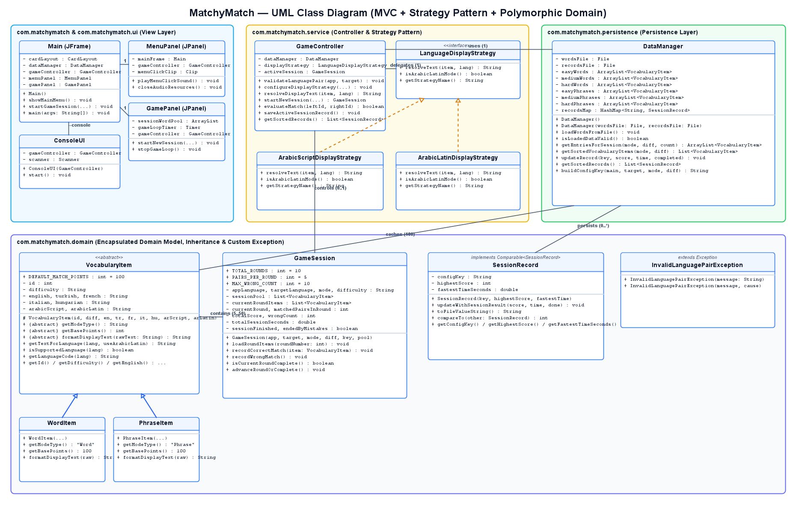
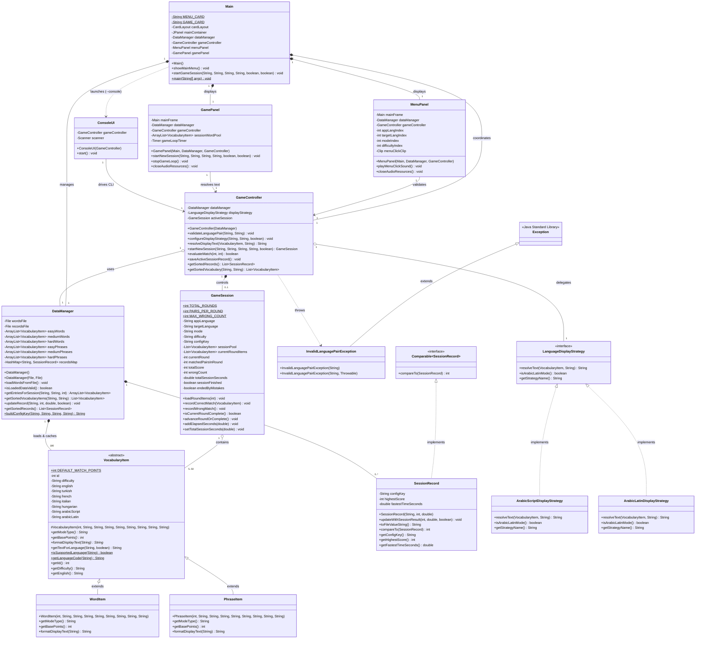

# MatchyMatch — UML Class Diagram & Object-Oriented Architecture

This document presents the complete Object-Oriented architecture and UML Class Diagram for **MatchyMatch**, covering all packages (`com.matchymatch`, `com.matchymatch.domain`, `com.matchymatch.service`, `com.matchymatch.persistence`, and `com.matchymatch.ui`), inheritance hierarchies, interface realizations, associations, compositions, and multiplicities.

---

## 1. Rendered UML Class Diagram Image

*(PlantUML source is also available at [`docs/uml_class_diagram.puml`](uml_class_diagram.puml)).*

---

## 2. Interactive Mermaid Class Diagram

---

## 3. Summary of Key Relationships

| Relationship Type | Source Class | Target Class / Interface | Description |
| :--- | :--- | :--- | :--- |
| **Inheritance (`extends`)** | `WordItem`, `PhraseItem` | `VocabularyItem` (Abstract) | Both concrete vocabulary classes inherit 9 encapsulated language fields and override `getModeType()`, `getBasePoints()`, and `formatDisplayText(String)`. |
| **Inheritance (`extends`)** | `InvalidLanguagePairException` | `java.lang.Exception` | Custom checked exception thrown when the user or caller selects identical or unsupported languages. |
| **Interface Realization (`implements`)** | `ArabicScriptDisplayStrategy`, `ArabicLatinDisplayStrategy` | `LanguageDisplayStrategy` | Strategy pattern implementations for switching between Arabic script (`مرحبا`) and Romanized Latin script (`Marhaba`) at runtime. |
| **Interface Realization (`implements`)** | `SessionRecord` | `Comparable<SessionRecord>` | Natural ordering of personal records by highest score descending, then fastest completion time ascending. |
| **Composition (`*--`)** | `DataManager` | `VocabularyItem` (`1..180`), `SessionRecord` (`0..*`) | `DataManager` owns the 6 categorized `ArrayList<VocabularyItem>` collections and the `HashMap<String, SessionRecord>` map. |
| **Aggregation (`o--`)** | `GameSession` | `VocabularyItem` (`5..50`) | Each 10-round session aggregates 50 polymorphic `VocabularyItem` instances and exposes 5 items per round. |
| **MVC Association (`-->`)** | `MenuPanel`, `GamePanel`, `ConsoleUI` | `GameController` | All three UI views delegate validation, strategy selection, and session management to `GameController`. |
